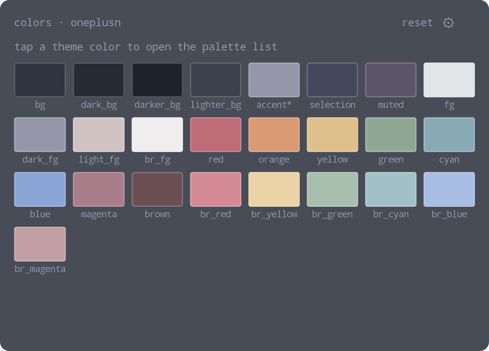
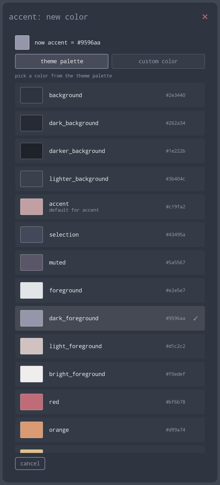
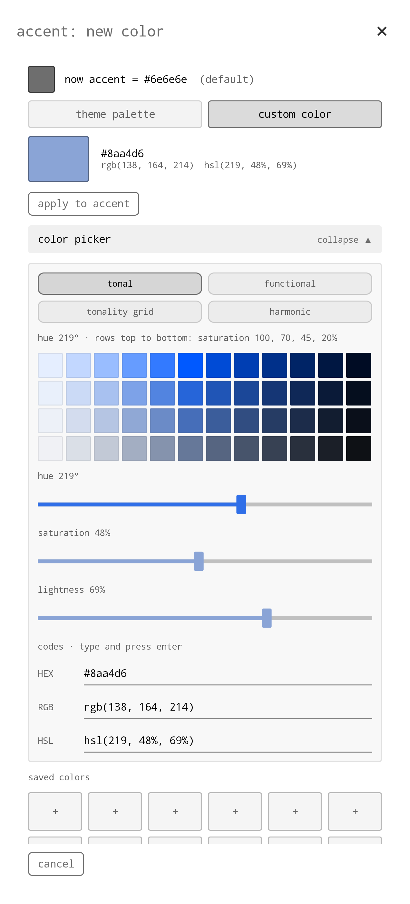
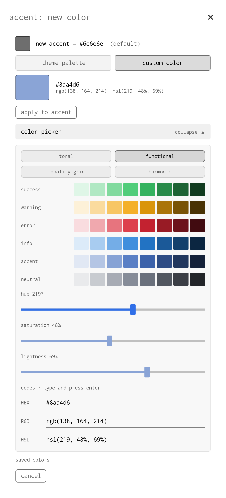
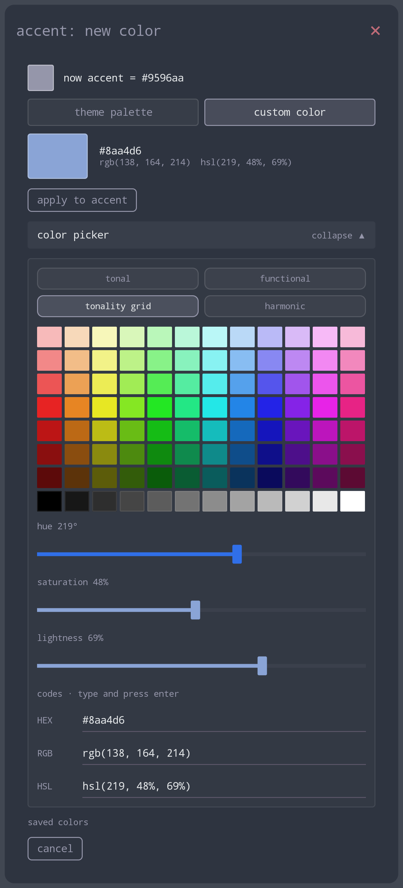
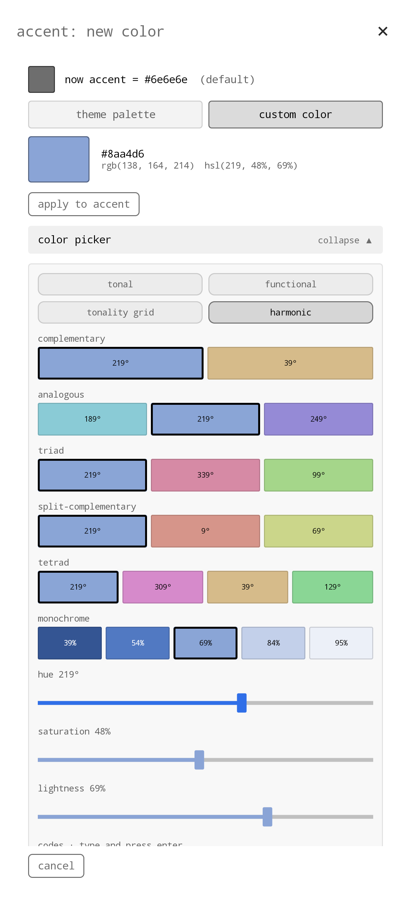

# theme colors 1.4.1

An [omalauncher](https://github.com/SimonSchubert/omarchy-widgets) home-screen widget that edits the active Omarchy theme's colors on the phone.

## What it does

- **Tile.** Shows every color in the theme's `colors.toml`; an asterisk marks the ones changed from the theme's defaults. Tap a color to open the picker.
- **Theme palette.** Pick any of the theme's own original colors; the variable's default is marked.
- **Custom color.** A collapsible picker with:
  - four palettes: tonal, functional, tonality grid and harmonic;
  - hue, saturation and lightness sliders that update live while you drag;
  - HEX, RGB and HSL input;
  - 12 slots for saved colors (tap an empty one to save, a filled one to pick, hold to clear).
- **reset** restores the theme's original colors.
- **⟳** re-reads the theme now. The tile also updates on its own as soon as the launcher applies a theme, after a theme switch on the phone or an edit.
- **Languages.** English by default; Russian, Ukrainian and Belarusian from the ⚙ menu. Those three are AI translations, and the menu says so.

The new color shows on the tile at once and in the whole theme about 2–3 seconds later.

<table>
  <tr>
    <td align="center" valign="top"> theme palette</td>
    <td align="center" valign="top"> tonal</td>
    <td align="center" valign="top"> functional</td>
    <td align="center" valign="top"> tonality grid</td>
    <td align="center" valign="top"> harmonic</td>
  </tr>
</table>

## Install

Install it from the launcher's widget store, or copy `widget.owl` to `~/.config/omalauncher/widgets/` (for example as `60-theme-colors.owl`). It shows up on the home screen within a second. Needed packages: `bash`, `coreutils`, `grep`, `sed`, `util-linux`; the tile offers to install any that are missing.

## How it changes the theme

- **Writing the color.** It changes one `key = "#rrggbb"` line in the theme's `colors.toml`, after checking the key and the value.
  - A stock theme first gets a copy in `~/.config/omarchy/themes`: its own `colors.toml` and links to the stock theme's other files. The stock files are never modified.
  - Before the first change, the original colors are saved as `colors.orig.toml` next to it. **reset** puts them back; for a stock theme it removes the copy, so Omarchy's later updates to that theme show again.
- **Re-applying the theme.** The launcher rebuilds a theme only when the `theme` name in `style.toml` changes. So the widget briefly switches `theme` to an identical temporary twin, `<theme>-reload`, then back, and removes the twin. Nothing flickers, and `style.toml` ends as it was.

## Authors

Made by [Svffer](https://github.com/Svffer) together with Claude Opus 5.5, Anthropic's AI model. Claude wrote the code and the translations; Svffer designed the widget, tested it on the phone and guided every change.

## License

[MIT](LICENSE)
